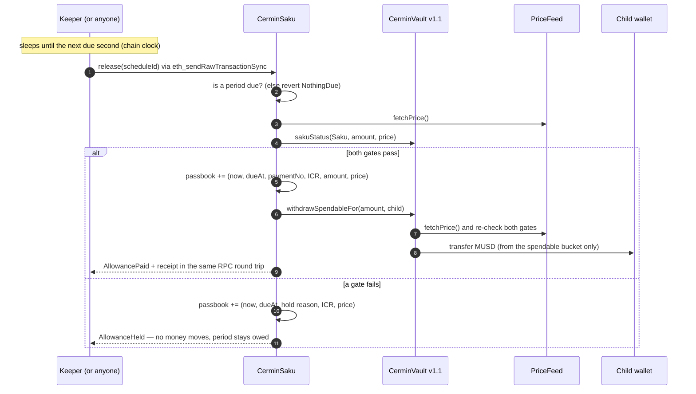
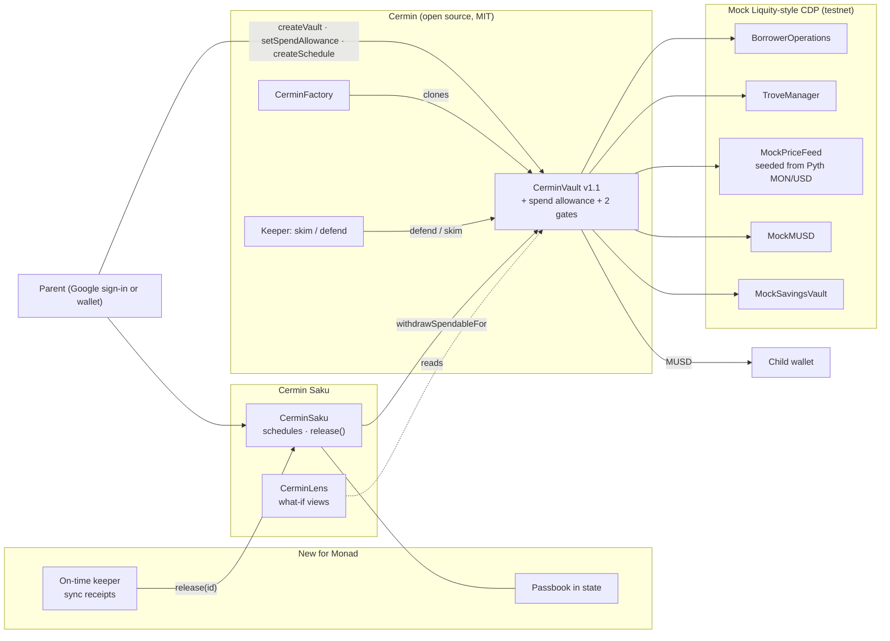

<div align="center">

# Cermin Saku on Monad

**An allowance that arrives the second it is due, and holds back when it is not safe.**
*Uang saku yang datang tepat di detik jatuh temponya, dan menahan diri saat posisi tidak aman.*

Scheduled allowances paid from a MON-backed vault on Monad. The vault contract itself refuses a payment
when the position is not safe and pays it once it is, and on Monad each payment lands within seconds of
falling due, provably, from timestamps the contract stores. Parents sign in with Google or email (a wallet
is created for them) or bring their own wallet; amounts show in Rupiah.

Monad Metropolis 2026 · Consumer Products & Payments · Monad testnet

<!-- PROOF-LINKS:START -->
Live app: *pending* · Demo video: *pending* · Demo vault, no wallet: *pending* · [Contracts on Monadscan](#contracts)
<!-- PROOF-LINKS:END -->

</div>

---

## The problem, in one family

A parent in Medan wants to send an allowance to a child at university in Jogja from crypto they hold, without
selling it every month. Borrowing against it works, but an allowance that keeps flowing while the price falls can
drain exactly the money the position needs to avoid liquidation. And for the child, an allowance that arrives
"sometime today" is not an allowance.

**Cermin Saku** turns a collateral-backed loan into scheduled envelopes for someone else, with two promises:

1. **Survival money comes first.** Before every payment the vault checks, at the live price, that the position is
   healthy *and* would survive another 30% fall. If not, the envelope is held (no money moves, it stays owed) and
   paid once the position is safe again. The vault enforces this, not the app.
2. **On time means on time.** On Monad the keeper wakes at the due second and the payment lands in the first blocks
   where it is allowed. The contract records both the due time and the paying block's time, so punctuality is
   something you can read from chain state, not a claim.

## What is new for Monad (built 10–12 Oct 2026)

| | What | Why it matters on Monad |
|---|---|---|
| **Passbook in contract state** | Every `release()`, paid or held, writes one line to `CerminSaku`'s passbook: when it ran, when that period was due, payment number or hold reason, ICR, amount, price. `passbook(id, offset, limit)` returns the history in one call. | Monad's public RPC serves `eth_getLogs` 100 blocks (~40 s) at a time. Rebuilding weeks of history from events would take tens of thousands of calls; the app now needs one per schedule and no indexer. |
| **On-time keeper** | The keeper sleeps until the next envelope falls due *on the chain's clock*, then releases it, instead of polling every few minutes. | With ~0.4 s blocks, "due at 09:00:00" can mean paid at 09:00:01. The passbook shows the gap for every payment. |
| **Receipts in one round trip** | The keeper sends through `eth_sendRawTransactionSync`, which returns the receipt once the block is in, and logs the measured time; it falls back to send + poll elsewhere. | The keeper knows "paid" or "held" in about a block time. |
| **Measured, not claimed** | In the app, after the parent signs, a badge shows how long the transaction took to land in a Monad block, timed in the browser. The app polls receipts every 150 ms instead of every 4 s. | The parent's first five minutes feel instant because they are, and the number on screen is the one we measured. |
| **"Tepat waktu di Monad" card** | `/demo` shows payments recorded, the median seconds from due time to paying block, and how many landed within 2 s, all computed from the passbook. | Judges can check punctuality without trusting us. |
| **Monad deployment** | 9 contracts on Monad testnet, the simulated price seeded from Pyth MON/USD, sized for faucet MON, gas limits padded 10% not 30% (Monad charges the gas limit). | — |

## Provenance: who built what, and when

This project has three layers. Everything we show for Monad Metropolis was built inside the six-week window
(1 Sep – 13 Oct 2026); the foundation underneath it was not, and is open source.

| Layer | When | Who | What |
|---|---|---|---|
| **Cermin** (foundation) | May 2026, before the window | Yeheskiel Yunus Tame, MIT ([original repo](https://github.com/yeheskieltame/Cermin)) | the vault engine (`CerminVault`, `CerminFactory`), the skim/defend keeper, the mock Liquity-style CDP, the web app's base design and watercolour illustrations. Commit [`e767fde`](https://github.com/Stylenecy/cermin-saku-monad/commit/e767fde) is that code, unchanged. |
| **Cermin Saku** | 5–7 Oct 2026 | Dex Bennett | `CerminSaku` (schedules, permissionless `release`, holds), the spend allowance and two safety gates in `CerminVault` v1.1, `CerminLens`, the keeper's allowance payer, 45 tests, the Bahasa Indonesia + Rupiah product with Google sign-in. Built for BNB Chain and submitted to the Indonesia Web3 Hackathon 2026; that version stays at [Stylenecy/cermin-saku](https://github.com/Stylenecy/cermin-saku). |
| **Cermin Saku on Monad** | 10–12 Oct 2026 | Dex Bennett | everything in the table above: passbook in state (+7 tests), on-time keeper with sync receipts (+3 tests), measured confirmation in the app, the punctuality card, Monad deployment and MON product copy. |

Every line we added is in dated commits; see [`CONTRIBUTIONS.md`](CONTRIBUTIONS.md) and `git log`.

## What this prototype proves, and what it does not

| Proven here | Not proven yet |
|---|---|
| The allowance policy is enforced **inside the vault**: `release()` checks, and `withdrawSpendableFor` re-checks | Mainnet economics: the mock CDP charges **no interest**; a real lending backend has a borrow rate |
| A real sequence on Monad testnet: paid → price drop → **held** → keeper **defends** → price recovers → owed envelopes paid | Oracle security: the demo price feed is owner-set so a crash can be shown on demand |
| Each payment's lateness, read from contract state (due time vs paying block) | Real liquidations (the mock does not liquidate) and stablecoin risk (MUSD is test money) |
| Anyone can call `release()`; a missing keeper delays payments but cannot make an unsafe one | Demand: no user interviews yet. No Rupiah off-ramp. One keeper process. Not audited |

Demo amounts are small on purpose: testnet MON comes from faucets, and the simulated price starts at the real
MON/USD price, so a vault of a few MON borrows a few cents. Streaming envelopes every minute makes small amounts
natural; the Lens and the calculator let you try any size.

Details: [`docs/THREAT-MODEL.md`](docs/THREAT-MODEL.md).

## Proof

| What | Evidence | How to check |
|---|---|---|
| Contracts tested | **85 forge tests passing**: 33 original Cermin + 28 Saku unit/fuzz + 7 passbook (incl. fuzz) + 2 crash-reserve stress + 7 Lens + 8 in the invariant suite (7 invariants + 1 positive control) | `cd contracts && forge test` |
| Passbook matches reality | fuzz `testFuzz_Passbook_MatchesPaidCounter`: random price paths, one line per release, payment numbers match the paid counter, never recorded before due | [`SakuPassbook.t.sol`](contracts/test/saku/SakuPassbook.t.sol) |
| Payment never made while unsafe | invariant `invariant_NoUnsafePayment` + fuzz `testFuzz_NeverPaysBelowFloor` | [`test/saku/`](contracts/test/saku) |
| Paying never eats the defense | fuzz `testFuzz_PaidAllowanceLeavesEnoughToDefendAfterStress` | [`SakuStress.t.sol`](contracts/test/saku/SakuStress.t.sol) |
| Keeper logic tested | **21 node:test passing** (incl. on-time wake timing) | `cd agent && npm test` |
| Full flow on Monad testnet | see [`docs/MONAD-DEPLOY.md`](docs/MONAD-DEPLOY.md): every transaction linked, with the keeper's measured receipt times | [Contracts](#contracts) |
| CI | GitHub Actions: forge build + test, keeper typecheck + test, web typecheck + lint + build | [`.github/workflows/ci.yml`](.github/workflows/ci.yml) |

## Judge path (5 minutes, no wallet needed)

1. Open **`/demo`** on the live app: a real vault on Monad testnet, read straight from the contracts.
2. Look at **Tepat waktu di Monad**: payments recorded and how many seconds after falling due each one landed, from the passbook.
3. In the **passbook**, find an envelope stamped **DITAHAN** (held): the reason (`IcrBelowFloor` or `ReserveTooThin`), the ICR and the price at that moment are stored on chain. No MUSD moved; the next lines show it paid later.
4. Drag the **"If MON goes to Rp X"** slider. Every number is returned by `CerminLens` via `eth_call`, the same math the vault executes.
5. Read [`CerminSaku.sol` → `release` and `_record`](contracts/src/CerminSaku.sol) and [`CerminVault.sol` → `_sakuStatus`](contracts/src/CerminVault.sol).

## How a payment is decided



### The two gates (in `CerminVault._sakuStatus`)

| Gate | Rule | Default (Balanced preset) |
|---|---|---|
| 1. Health floor | `ICR ≥ defendICR + floorBuffer` | keeper defends at 140%, so allowances stop below **150%** |
| 2. Crash reserve | `spendable − amount + savings ≥ repay that defend() would need to restore defendICR after a stress% drop` | after another **30%** fall, enough is left for `defend()` to bring ICR back to **140%** |

The owner can tune the policy within hard bounds (buffer 5–50 points, crash reserve 10–70%) but cannot turn it off.
The owner's allowance (`setSpendAllowance`) caps what Saku can move. Payments come only out of the spendable
bucket; savings stay as the defense reserve and the MON collateral is never touched.

## Architecture



## Contracts

<!-- CONTRACTS:START -->
*Deployment pending.*
<!-- CONTRACTS:END -->

| Contract | Source | Role |
|---|---|---|
| `CerminSaku` | [src/CerminSaku.sol](contracts/src/CerminSaku.sol) | schedules, permissionless `release`, holds, **passbook** |
| `CerminLens` | [src/CerminLens.sol](contracts/src/CerminLens.sol) | price lines, previews of defend / skim / Saku |
| `CerminVault` v1.1 | [src/CerminVault.sol](contracts/src/CerminVault.sol) | Cermin's vault + spend allowance + the two gates (`git diff e767fde -- contracts/src/CerminVault.sol`) |
| `CerminFactory` | [src/CerminFactory.sol](contracts/src/CerminFactory.sol) | Cermin's, unchanged |
| Mock CDP | [test/mocks](contracts/test/mocks) | Cermin's mocks; admin functions owner-only for a public testnet |

Demo parameters: the price feed is a **simulated** `MockPriceFeed` owned by our deployer, seeded from Pyth MON/USD
at deploy time, so drops can be shown on demand. Min debt / gas compensation are deploy-time settings (0.01 / 0.001
MUSD on the testnet demo, so a faucet-sized vault works at the real MON price).

## Run it

**Contracts**
```bash
cd contracts
git clone --depth 1 --branch v5.6.1 https://github.com/OpenZeppelin/openzeppelin-contracts.git lib/openzeppelin-contracts
git clone --depth 1 --branch v1.16.2 https://github.com/foundry-rs/forge-std.git lib/forge-std
forge test
```

**Deploy (Monad testnet, one command)**
```bash
bash scripts/rehearse-fork.sh    # the whole deploy against a local anvil fork of Monad testnet, no MON spent
bash scripts/deploy-monad.sh     # keys from ./wallets.env (gitignored): deploy, Sourcify, demo vault, wire web + keeper + README
```

**Keeper**
```bash
cd agent && npm ci && npm test
npm run keeper   # reads agent/.env written by post-deploy; SAKU_ON_TIME=true by default
```

**Web**
```bash
cd frontend && npm ci
npm run dev   # addresses come from frontend/.env.production, written by scripts/post-deploy.mjs
```
Sign-in uses [Privy](https://privy.io) (Google, email or a wallet; an embedded wallet is created on login) when
`NEXT_PUBLIC_PRIVY_APP_ID` is set, and falls back to RainbowKit's wallet connect when it is empty.

## Limits we own up to

- **Mock CDP.** The vault runs on the original mock stack. MUSD is play money, and the mock does not execute liquidations.
- **Simulated price.** The demo feed is owner-settable so a crash can be shown.
- **One keeper.** `release()` is permissionless and the vault re-checks every payment, so a missing keeper delays payments; it cannot make an unsafe one. Punctuality depends on the keeper being up.
- **Recent activity only for defend/skim.** Those events come from logs (100-block windows), so the app reads the recorded demo blocks plus the last ~1,000 blocks; allowance history is complete because it lives in state.
- **Rupiah is display only.** An indicative USD/IDR rate with a dated fallback. No bank off-ramp.
- **Not audited.** Hackathon code on testnet.

## Roadmap

Real lending backend on Monad · Rupiah off-ramp partner · gas sponsorship so a Google sign-in can open a vault
with zero MON · recipient-side spending limits · multiple keepers.

## License

MIT, see [LICENSE](LICENSE). Copyright © 2026 Yeheskiel Yunus Tame (Cermin) and © 2026 Dex Bennett (Cermin Saku additions).
